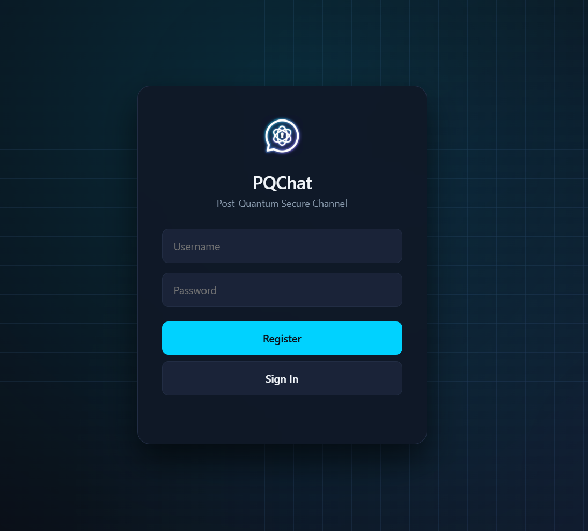
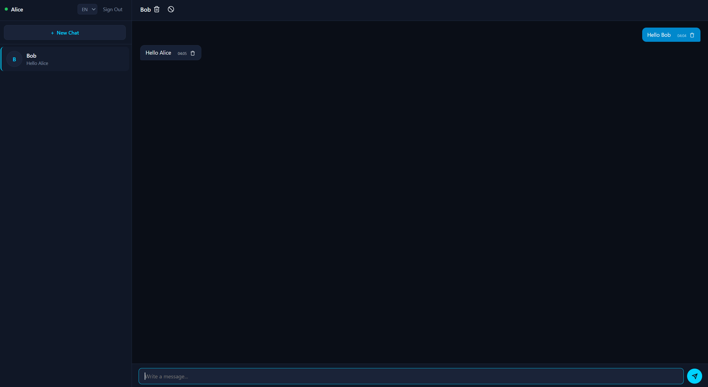

# 🛡️ PQChat

A production-ready, post-quantum secure messaging web application built with **FastAPI**, **Vanilla JS**, and **PostgreSQL**. Designed to protect communications against quantum computing threats (*Harvest Now, Decrypt Later*) using **NIST FIPS 203 (ML-KEM-768)**, **NIST FIPS 204 (ML-DSA-65)**, and **AES-256-GCM**, reinforced by a Zero-Knowledge Challenge-Response authentication workflow and HTTP-only cookie session security.

Tested and validated both in **Local Development Mode** and in a **Cloud Deployment Environment** (tested using **Render** for Web Service Hosting and **Neon** for Serverless PostgreSQL).

---

## 📸 Application Interface

<table border="0" width="100%">
  <tr>
    <td align="center" valign="middle" width="45%">
      
    </td>
    <td align="center" valign="middle" width="55%">
      
    </td>
  </tr>
</table>

<p align="center">
  <em>Figure 1: (a) Registration and sign-in page. (b) Active chat interface showing a messaging session.</em>
</p>

---

## 🏛️ System Architecture & Cryptographic Stack

The application relies on a multi-layered post-quantum security model designed around NIST standards and zero-knowledge protocol principles:

```text
┌─────────────────────────────────────────────────────────────────────────────────┐
│                                CLIENT (Browser)                                 │
│  - ML-KEM-768 Key Generation & Encapsulation                                    │
│  - ML-DSA-65 Identity Signing & Challenge Response                              │
│  - AES-256-GCM Payload Symmetric Encryption                                     │
└────────────────────────────────────────┬────────────────────────────────────────┘
                                         │
                                 HTTPS / REST API
                                         │
┌────────────────────────────────────────▼────────────────────────────────────────┐
│                                BACKEND (FastAPI)                                │
│  - ZK Challenge-Response Verification                                           │
│  - Secure HTTP-Only Cookie Session Management                                   │
│  - RESTful Mailbox Routing & Payload Storage                                    │
└────────────────────────────────────────┬────────────────────────────────────────┘
                                         │
                                TLS / SSL Connection
                                         │
┌────────────────────────────────────────▼────────────────────────────────────────┐
│                              DATABASE (PostgreSQL)                              │
│  - Encrypted Private Key Blobs & Public Keys                                    │
│  - Session Identifiers & Encrypted Ciphertext Mailbox                           │
└─────────────────────────────────────────────────────────────────────────────────┘
```
### Security Stack Breakdown

| Layer | Standard / Technology | Technical Purpose |
| :--- | :--- | :--- |
| **Key Encapsulation** | **ML-KEM-768** (FIPS 203) via `@noble/post-quantum` | Ephemeral quantum-resistant key exchange |
| **Digital Signatures** | **ML-DSA-65** (FIPS 204) via `@noble/post-quantum` | Post-quantum identity verification & challenge signing |
| **Symmetric Encryption** | **AES-256-GCM** via Web Crypto API (`crypto.subtle`) | Authenticated payload and local chat storage encryption |
| **Key Derivation** | **PBKDF2 & HKDF-SHA256** via Web Crypto API | Local key wrapping from passwords and session key expansion |
| **Authentication** | **ZK Challenge-Response** | Proof of private key ownership without password transmission |
| **Session Security** | **HTTP-Only Cookies** | Secure session management resistant to XSS token theft |
| **Backend API** | **FastAPI** | Asynchronous HTTP REST endpoints |
| **Database** | **PostgreSQL / SQLite** | Relational storage for public keys, key blobs, and mailbox queues |

---
## 💡 How It Works (In Simple Terms)

If you aren't familiar with post-quantum cryptography or web security, here is a simple breakdown of how PQChat protects your privacy:

### 1. The Core Rule: A "Blind and Deaf" Server
In PQChat, **the server is completely blind**. All encryption, decryption, and key creation happen **inside your web browser** using JavaScript. Plaintext messages and raw secret keys never leave your device.

---

### 2. Step-by-Step Security Journey

#### 🚪 Step 1: Account Creation (*Zero-Password Storage*)
* When you create an account, your browser generates two pairs of mathematical keys using post-quantum algorithms:
  * **ML-KEM-768:** Used to encrypt and decrypt messages.
  * **ML-DSA-65:** Used as your digital identity/signature.
* Your password is used locally to lock your secret keys inside an encrypted "vault" (using AES-GCM). Only the public keys and this encrypted vault are sent to the server.

#### 🔑 Step 2: Sign-In (*Zero-Knowledge Authentication*)
* Instead of sending your password over the internet to log in, the server sends your browser a random temporary puzzle (a *challenge*).
* Your browser unlocks your local secret key with your password and signs the puzzle.
* The server checks the signature. If it matches, you are logged in. **Your password never travels across the network.**

#### ✉️ Step 3: Sending a Message (*Post-Quantum Encryption*)
When Alice sends "Hello Bob":
1. **Key Exchange:** Alice's browser grabs Bob's public key from the server and uses **ML-KEM-768** to establish a quantum-safe shared secret key.
2. **Symmetric Encryption:** The actual message "Hello Bob" is encrypted using that key via **AES-256-GCM**.
3. **Digital Signature:** Alice signs the encrypted bundle using her **ML-DSA-65** private key to prove the message genuinely came from her.
4. **Transmission:** The scrambled ciphertext is sent to the server's mailbox. Even if someone intercepts it or if a future quantum computer tries to break it, they only see meaningless digital noise.

#### 📬 Step 4: Receiving & Local Storage
* Bob's browser regularly asks the server: *"Are there any new messages for me?"*
* When Bob receives Alice's message, his browser verifies Alice's signature, uses his secret key to unlock the quantum key, and decrypts the text to display "Hello Bob".
* Decrypted chats are stored safely inside Bob's browser memory (`localStorage`), encrypted with his session key.

---

### 🧪 Why Post-Quantum Matters (*Harvest Now, Decrypt Later*)
Today's supercomputers cannot break modern encryption (like RSA or ECC). However, malicious actors can record and store encrypted internet traffic today (*Harvest Now*) and wait until powerful **quantum computers** arrive in the future to break those keys and read historical conversations (*Decrypt Later*). 

**PQChat** uses the new **NIST FIPS 203 & 204** standards to ensure that even if your traffic is captured today, future quantum computers will never be able to decrypt your messages.

## ✨ Key Features & Privacy Controls

* **Zero-Knowledge Authentication:** Proof of private key ownership via ML-DSA-65 signatures (passwords never leave the browser).
* **Post-Quantum E2EE Mailbox:** Asynchronous message routing powered by ephemeral ML-KEM-768 key encapsulation and AES-256-GCM.
* **Granular Data Control (`server.py`):**
  * **Individual & Bulk Deletion:** Users can delete specific messages or wipe entire chat histories directly from the database server.
  * **Mutual User Blocking:** Instant messaging restriction verified backend-side prior to database insertion.
* **Background Notifications (`server.py`):** Privacy-friendly WebPush integration via VAPID keys (*notifications alert users without leaking encrypted payloads*).

## 🌐 Environment Setup & Architecture

PQChat provides three distinct backend entry points tailored for local development, cloud demos, and full production deployments:

| Server File | Database | Target Environment | Key Features |
| :--- | :--- | :--- | :--- |
| **`server_local.py`** | SQLite (`local_pqchat.db`) | Local Development | Zero-config setup, runs instantly on `127.0.0.1:8000`. |
| **`server_cloud.py`** | PostgreSQL | Cloud Demos / PaaS | Lightweight cloud-agnostic setup (Render, Railway, etc.). |
| **`server.py`** | PostgreSQL | Full Production (**Q-Studio Store App**) | Full feature set: **WebPush (VAPID)**, **PWA assets**, **User blocking**, and **Granular chat deletion**. |

---

### 1. Running Locally (`server_local.py`)

No cloud connections or external databases required. 

1. Install dependencies: `pip install -r requirements.txt`
2. Run the local server: `python server_local.py`
3. Open your browser at `http://127.0.0.1:8000`.

> **💡 Testing Multi-User Chat Locally:** Use two different browsers (e.g., Chrome and Edge) to test chatting between Alice and Bob.

---

### 2. Deploying to the Cloud (`server_cloud.py` or `server.py`)

To host PQChat live, deploy to any Python-supported host with a PostgreSQL instance:

1. **Environment Variables Required:**
   * `DATABASE_URL`: Your PostgreSQL connection string.
   * `VAPID_PRIVATE_KEY` *(Only required if running `server.py`)*: Private key for background push notifications.
2. **Build & Start Commands:**
   * **Build Command:** `pip install -r requirements.txt`
   * **Start Command:** `uvicorn server:app --host 0.0.0.0 --port $PORT` (or `server_cloud:app` for the lightweight version).

---

## 🔬 Traffic Interception & Statistical Audit

To verify that message ciphertexts generated during active sessions are strictly ephemeral, unbiased, and compliant with NIST specifications, live network traffic was captured and analyzed using a custom statistical test suite (`audit_pqc.py`).

---

### 1. Intercepting Live Traffic (`messages_interceptor.js`)

Traffic interception is achieved directly in the browser using a lightweight Fetch API monkey-patch snippet:

1. Open PQChat in the browser and open **Developer Tools** (`F12`).
2. Paste the contents of `messages_interceptor.js` into the **Console** tab.
3. Send 100 messages through the chat interface.
4. Run `downloadSamples()` in the browser console to extract `pqc_messages.txt` (containing 100 Base64-encoded ML-KEM-768 ciphertexts).

> **Note:** The repository includes the original dataset (`pqc_messages.txt`) used during formal validation.

---

### 2. Statistical Methodology & Acceptance Criteria

The audit script processes the raw binary payloads extracted from `pqc_messages.txt` across four rigorous cryptographic checks:

#### A. Payload Uniqueness & FIPS 203 Dimensionality
- **Meaning:** Verifies that every key encapsulation exchange generates a unique ciphertext payload and matches the exact byte-length requirement specified in NIST FIPS 203 for ML-KEM-768 (`1088 bytes`).
- **Bound Justification:** Ensures proper ephemeral key generation (`100% uniqueness`) with zero replay or static key reuse.

#### B. Shannon Entropy ($H$)
- **Meaning:** Measures the average information density and randomness of the output byte stream.
- **Equation:** $H(X) = -\sum_{i=0}^{255} P(x_i) \log_2 P(x_i)$
- **Bound Justification:** Since each byte contains 8 bits, maximum random entropy is `8.0 bits/byte`. Values close to 8.0 (e.g., `> 7.99`) confirm that ciphertext bytes are uniform and contain no structural pattern or leakage.

#### C. Chi-Square Goodness-of-Fit Test ($\chi^2$)
- **Meaning:** Evaluates whether the frequency distribution of all observed byte values (`0–255`) deviates from a theoretical uniform distribution.
- **Equation:** $\chi^2 = \sum_{b=0}^{255} \frac{(O_b - E_b)^2}{E_b}$ *(where O<sub>b</sub> is observed byte count and E<sub>b</sub> = N / 256 = 108800/256 = 425.0 is expected frequency)*
- **Bound Justification (`180.0 – 330.0`):** For $k = 256$ byte categories, the test has $df = 255$ degrees of freedom. The expected mean is $E[\chi^2] = 255$. The acceptance range corresponds to a $99\%$ confidence interval ($\alpha = 0.01$). Values within this range prove the output is statistically indistinguishable from uniform random noise.

#### D. Bit Avalanche Effect (Hamming Distance)
- **Meaning:** Measures the percentage of bit flips between consecutive ciphertext samples to verify non-linear diffusion and independence between sessions.
- **Equation:** $\text{Avalanche Rate} = \frac{\sum \text{popcount}(A_b \oplus B_b)}{\text{Total Bits}} \times 100$
- **Bound Justification (`45.0% – 55.0%`):** Ideal cryptographic diffusion flips exactly `50.0%` of bits when inputs change or independent keys are generated. Bounds of `50% ± 5%` confirm strong bit independence across adjacent session samples.

---

### Audit Results

| Cryptographic Check | Observed Metric | Target Bounds | Status |
| :--- | :--- | :--- | :--- |
| **Payload Size** | `1088 bytes` | `1088 bytes` (FIPS 203) | ✅ PASS |
| **Uniqueness** | `100/100 (100%)` | `100%` Unique | ✅ PASS |
| **Shannon Entropy** | `7.9981 bits/byte` | `~8.0000 bits/byte` | ✅ PASS |
| **Chi-Square ($\chi^2$)** | `284.31` | `[180.0, 330.0]` ($\alpha = 0.01$) | ✅ PASS |
| **Bit Avalanche Rate** | `49.95%` | `~50.0%` | ✅ PASS |
